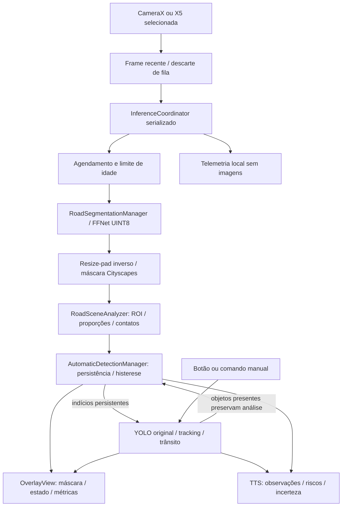

# Detecção automática visual de ruas — SenseWalk 2.4.4 com confirmação

## Atualização 2.4.8 — fala somente por mudança de condição

Removidos os três avisos periódicos de monitoramento e o controle de intervalo nas configurações. Semáforo, veículos, aproximação, alinhamento e avisos de falha/inconclusivo agora mantêm estado por assunto: depois de uma fala aceita pelo TTS, o mesmo valor não volta a ser anunciado pelo simples passar do tempo. “Aguarde” e “Nenhum veículo detectado na imagem” não têm mais repetição temporizada.

Uma mudança confirmada permite novo aviso, inclusive quando um perigo desaparece e depois reaparece. Ausência de aproximação precisa persistir por 1,5 s; alinhamento muda após 1,2 s e sua ausência é confirmada em 2 s. Preservados os 3 s de confirmação para ausência de veículos ou veículos parados, com contagens separadas por tipo de observação. O aviso genérico de veículos é suprimido durante o alerta específico de aproximação. Reiniciar a análise rearma os avisos da cena.

A fila remove estados substituídos; mensagens recusadas, expiradas ou retiradas antes de serem enviadas ao TTS não são marcadas como faladas. Perguntas de consentimento, sua segunda tentativa intencional e os comandos manuais de status/ajuda permanecem. Textos de situação/estado inalterados não são reatribuídos às regiões de acessibilidade.

Validação local: **45 testes JVM, zero falhas/erros**, incluindo 11 novos testes de silêncio prolongado com relógio de teste, recorrência, estabilização e fila. APK debug gerado; 16 bibliotecas nativas de 64 bits verificadas para páginas de 16 KB. Pesos YOLO e FFNet mantêm os mesmos SHA-256. Não há nova inferência simulada nem mudança de classes.

**2.4.8 instalada em 11/11/2026:** após a porta anterior ser recusada, o aparelho reconectou em `192.168.100.230:39385`. `adb install -r` retornou `Success`; o gerenciador de pacotes confirmou `versionCode=13` e `versionName=2.4.8-quiet-transitions`. A tela inicial foi aberta com `am start --user 0`. A validação auditiva prolongada e a estabilidade das transições em cena continuam pendentes; a captura USB HD foi validada anteriormente na 2.4.7.

## Atualizações 2.4.6/2.4.7 — passagem ao YOLO e avisos específicos

Corrigido o cancelamento da pergunta por atraso isolado de FFNet. Enquanto `AWAITING_CONFIRMATION`, a segmentação pesada pausa para liberar processamento ao reconhecimento offline, mantendo captura/preview e watchdog. O sinal sonoro ocorre em `onReadyForSpeech`, não ao solicitar o microfone.

Um sim válido passa a `STARTING_ANALYSIS`: a próxima imagem válida precisa confirmar pista antes de `ACTIVE_ANALYSIS`. Não se rejeita um sim somente porque a amostra anterior envelheceu durante a pergunta. Sem imagem nova válida em dez segundos, não se inicia análise e há aviso inconclusivo. A fala “Análise de veículos e semáforos ativa” só ocorre após o primeiro resultado YOLO recente entregue ao pipeline.

Registros no aparelho confirmaram `Consent accepted=true scheduled=true state=STARTING_ANALYSIS`, seguido de `First fresh YOLO result...`; a interface apresentou análise ativa e detecções de veículos. Isso confirma a passagem do consentimento ao YOLO, não a precisão das detecções. Nas tentativas de fala observadas, houve também respostas ambíguas (`Speech parsed=unknown`); não declarar reconhecimento de voz plenamente validado. Agora há uma repetição com sinal, vocabulário sugerido localmente e botões preservados quando a fala continua ambígua.

As mensagens foram encurtadas para fatos observados: “Nenhum veículo detectado na imagem”, “Veículos detectados, sem movimento aparente” e estados específicos de imagem atrasada ou segmentação inconclusiva. A falha isolada de segmentação não anuncia falha geral se houver resultado YOLO recente. Repetição de inconclusivo limitada a uma vez por minuto. “ANÁLISE DA VIA” substitui o título “VIA LIVRE”. Nenhuma ausência de detecção gera autorização para atravessar.

Foram acrescentados quatro testes de regressão da transição e três da seleção de qualidade USB, totalizando 34 testes JVM. Captura HD validada conforme `DOCUMENTACAO_CAMERA_USB.md`. Fluxo de voz completo, falsos positivos/negativos e estabilidade prolongada continuam sujeitos a validação.

**Atualização 2.4.5:** fonte USB/UVC implementada. Enumeração, carregamento nativo, recepção RGB 640×360 e entrada na análise YOLO testados com HiCamera. Validação FFNet/consentimento com cenas da webcam ainda pendente. Estado atual em [DOCUMENTACAO_CAMERA_USB.md](DOCUMENTACAO_CAMERA_USB.md); substitui a pendência USB da auditoria original abaixo.

## Atualização: consentimento antes do YOLO

Após pista ≥12% persistir pelo tempo configurado, o estado passa a `AWAITING_CONFIRMATION`. A calçada/limite continuam sendo calculados e exibidos, mas pista isolada agora pode gerar **a pergunta**, nunca iniciar o YOLO sem resposta. O app pergunta “Rua detectada. Deseja atravessar? Diga sim ou não após a pergunta.” e só abre reconhecimento **local/offline** após o `onDone` real do TTS.

Apenas resposta afirmativa inequívoca (ou botão Sim) permite análise intensificada. Não, silêncio, erro, fala ambígua, desaparecimento da pista, confirmação vencida ou cena sem amostra recente não iniciam o YOLO. Timeout de 24 s na interface/25 s na política. Após recusa, não se repete para a mesma pista ainda visível; é preciso ausência de pista pela histerese configurada. Início manual continua disponível. A confirmação é para iniciar análise, não uma autorização de travessia.

O Android solicita permissão de microfone ao ativar o monitoramento. É necessário um serviço de reconhecimento on-device compatível e idioma offline instalado. Sem ele, o app informa a indisponibilidade e oferece botões acessíveis Sim/Não, sem recorrer a reconhecimento na nuvem. Teste auditivo de sim/não com uma pessoa ainda precisa ser realizado no aparelho.

Novos arquivos: `road/CrossingAnswer.kt` e `road/CrossingConsentController.kt`. A política, coordenador, MainActivity, TTS e textos foram atualizados. Cinco novos testes verificam recusa, timeout, perda de pista, parser estrito e rearme: **24 testes JVM** ao todo. As seções abaixo descrevem a arquitetura original, com esta confirmação substituindo sua ativação direta.

## 1. Objetivo e estado da entrega

Monitorar visualmente a imagem e ativar o pipeline YOLO existente após indícios persistentes de pista/calçada, sem botão a cada evento. Não há GPS, localização, mapas, treinamento ou consulta de rede na inferência. Não houve migração de frontend: o app é Kotlin Android.

Implementados: carregamento real FFNet, segmentação, coordenador compartilhado, máquina de estados, opções, sobreposição, voz e telemetria. Build, testes JVM e inferências instrumentadas no SM-S731B executados. **Ainda não validados: aproximação real de meio-fio, câmera em caminhada, desempenho sustentado, falsos positivos/negativos dos dez cenários e webcam USB. Não considerar esta entrega um sistema validado para orientar uma travessia.**

## 2. Auditoria da arquitetura existente

- `ui/MainActivity.kt`: CameraX `ProcessCameraProvider`, câmera traseira, `KEEP_ONLY_LATEST`, executor único; início/parada manual, permissões e ciclo de vida.
- `camera/FrameAnalyzer.kt`: conversão ImageProxy → Bitmap, rotação, YOLO, optical flow, tracking, máquina de trânsito, caixas e benchmark.
- `camera/ExternalFrameProcessor.kt`: mesmo processamento lógico para imagens X5; não cria outro detector YOLO.
- `detection/YoloDetector.kt`: modelo `assets/model.tflite` via mmap, CPU com quatro threads, buffers reutilizados e bloqueio de inferência. **Arquivo, classes e pesos YOLO não foram alterados.**
- `camera/X5CameraClient.kt`: câmera Wi-Fi/RTSP JPEG experimental. A rede local dessa câmera é independente da inferência offline.
- `voice/VoiceSystem.kt` e `VoicePriority.kt`: TTS, fila, prioridades e cooldowns reutilizados.
- `SettingsActivity`, `AppConfig`, `LanguageManager`: configurações e três idiomas preservados.

## 3. Modelo utilizado e licença

Qualcomm **FFNet-122NS-LowRes**, export oficial **v0.66.0, TFLite w8a8**, não um modelo convertido ou retreinado nesta entrega.

Fontes verificadas:

- https://huggingface.co/qualcomm/FFNet-122NS-LowRes
- https://huggingface.co/qualcomm/FFNet-122NS-LowRes/raw/main/release_assets.json
- https://qaihub-public-assets.s3.us-west-2.amazonaws.com/qai-hub-models/models/ffnet_122ns_lowres/releases/v0.66.0/ffnet_122ns_lowres-tflite-w8a8.zip
- Código de referência: `qualcomm/ai-hub-models`, tag `v0.66.0`, `src/qai_hub_models/models/templates/cityscapes_segmentation/{model,app,ffnet_model}.py`.

Licença original BSD-3-Clause com ressalva de patentes, copyright Qualcomm 2022. Texto integral distribuído em `assets/ffnet_LICENSE.txt`, acessível em Configurações → Licença e créditos FFNet. `ffnet_metadata.json` e `ffnet_labels.txt` são os arquivos oficiais do pacote. Não se requer SDK Qualcomm, NPU, conta AI Hub ou internet no aparelho: LiteRT 1.4.2 executa o grafo na CPU, com duas threads.

SHA-256 do FFNet: `814ed92970669c0fe1f436e07733cdd41247cddc741c21657d51dadabfdff34f`.

SHA-256 do YOLO original, conferido antes/depois: `b11df3830eb40b413fa1dea0a845c17f1d2af38ebc3fb1e599aff50c0ac4a8fd`.

## 4. Contrato real dos tensores

Inspecionado com `Interpreter` no Android, e não apenas inferido da extensão:

| Tensor | Formato | Tipo | Escala | Zero point |
|---|---|---|---|---|
| Entrada `image` | NHWC `[1,512,1024,3]` | UINT8 | 0.003920366987586021 | 0 |
| Saída `mask` | NHWC `[1,128,256,19]` | UINT8 | 0.20315125584602356 | 153 |

RGB: componente/255, depois `round(valor/scale)+zeroPoint`, saturado em 0..255. O wrapper oficial inclui normalização ImageNet **dentro do grafo**; não a aplicar novamente. Resize com preservação de aspecto e padding preto central, seguindo o app oficial. A rotação é aplicada antes da segmentação.

Saída são escores quantizados por classe. Interpolamos escores bilinearmente, removemos padding e fazemos argmax numa máscara 256×128 alinhada ao frame orientado. Os IDs não são interpolados. Não se produz confiança probabilística: `confidence = null`. A máscara é exibida com FILL_CENTER, como o preview. Não representa distância física.

Ordem dos trainIds Cityscapes, base zero:

`road, sidewalk, building, wall, fence, pole, traffic light, traffic sign, vegetation, terrain, sky, person, rider, car, truck, bus, train, motorcycle, bicycle`.

FFNet delimita regiões/pixels. YOLO mantém suas classes e caixas para veículos, semáforos e faixa: um não substitui o outro.

## 5. Fluxo e componentes novos



Não existe segunda captura ou inferência pesada na thread UI. Ambos os modelos usam os mesmos bitmaps de uma fonte, serializados pelo coordenador. CameraX descarta frames intermediários. X5 usa canal de capacidade um; seus bitmaps descartados/consumidos são liberados, e o preview tem cópia com propriedade independente para evitar reciclagem durante desenho. Máscaras só são desenhadas em modo desenvolvedor. Os intérpretes e buffers FFNet são liberados ao pausar/parar; sair da tela interrompe monitoramento. A opção é desativada por padrão e a permissão de câmera continua obrigatória.

## 6. Estados, regras e segurança

- `STOPPED`: desligado pelo usuário.
- `MONITORING`: FFNet periódico, pista pode estar visível sem indício suficiente de limite.
- `POSSIBLE_CROSSING`: contato pista/calçada persistindo.
- `ACTIVE_ANALYSIS`: YOLO intensificado, FFNet continua com orçamento reduzido.
- `INCONCLUSIVE`: imagem sem indícios suficientes ou resultado vencido.
- `ERROR`: câmera/vídeo/modelo indisponível, com aviso; recuperação por parar/reabrir/reativar nas configurações.

ROI: metade inferior, dois terços centrais. Pista ≥12%, calçada ≥5%, contatos entre rótulos ≥0,2% da ROI. São **heurísticas experimentais**, não calibradas com conjunto de validação. Pista isolada nunca ativa. Confirmação padrão 1.500 ms com amostras distintas e sem lacunas maiores que 1.500 ms. Rumo, distância até o meio-fio e posição do usuário não são inferidos.

Retorno: ausência de pista por 10 s **e** ausência de evidências YOLO (veículos/contexto) por pelo menos 10 s. Cooldown de 15 s. Uma perda isolada de FFNet não desliga análise ativa. Falha FFNet preserva YOLO já ativo/manual, sem tentar uma inferência quebrada a cada frame.

Idade máxima de 1.500 ms: antes e depois de inferências. Resultado atrasado não aciona travessia nem alertas de trânsito. Watchdog de vídeo de 3 s limpa overlay e avisa quando não chegam frames. CameraX também observa erros CameraState; X5 conserva sua verificação de frames vencidos/desconexão.

Botão Parar e comando “parar” interrompem o automático. O comando “iniciar” permite assumir análise manual. Para trocar de câmera, parar primeiro, selecionar a fonte e reativar. O automático não bloqueia o modo manual por falha FFNet.

A máquina de trânsito não marca ausência de veículos como `SEGURO`; informa somente condições observadas e incerteza. Semáforo vermelho e aproximação de veículos conservam prioridade superior ao contexto automático. Nenhum alerta autoriza atravessar. Optical flow existente continua no tracking YOLO; **não há estimação validada de ego-movimento na decisão FFNet**.

## 7. Configuração e depuração

Configurações → **Detecção automática de ruas**:

- Ativação/desativação.
- Modo desenvolvedor: pista roxa, calçada ciano, caixas YOLO e diagnósticos.
- FFNet solicitado 1–5 FPS (padrão 2), YOLO limitado a 1–30 FPS (padrão 15).
- Confirmação, histerese de saída e cooldown em milissegundos.
- Textos/avisos em português, inglês e espanhol, reutilizando TTS.

Frequências são limites, **não promessas de desempenho**. Durante análise YOLO, intervalo FFNet cresce para pelo menos cinco vezes seu custo total anterior, visando priorizar YOLO. Aumentar FPS solicitado não acelera a CPU. Debug não muda limiares/decisões.

Ativar benchmark técnico registra `Android/data/com.travessia.segura/files/benchmarks/road_*.csv`: estado, inferência FFNet, pipeline YOLO, idade total, CPU da thread, skips de agendamento, taxas médias de callbacks/modelos, heap Java e status térmico Android. Não representa uso global de CPU, tempo de GPU, contagem de descartes internos CameraX ou latência real até o fim do áudio. GPU não é utilizada. Métricas YOLO existentes permanecem disponíveis em sessões manuais.

## 8. Webcam USB — pendência explícita

O código usa câmera traseira CameraX ou X5 Wi-Fi, **não há USB Host/UVC**. Enumeração Camera2 no S25 FE durante o teste mostrou IDs 0/2 traseiros e 1/3 frontais; nenhum `LENS_FACING_EXTERNAL`. Isso não prova que uma webcam nunca aparecerá em outra configuração, mas não autoriza dizer que a webcam está integrada.

As quatro câmeras enumeradas informaram `SENSOR_INFO_TIMESTAMP_SOURCE_REALTIME=1`, compatível com o relógio monotônico usado na rejeição de frames. Relógio/timestamps de outros aparelhos/fontes precisam ser verificados; discrepâncias são recusadas como frames vencidos, não consideradas evidência válida.

Pendência: escolher e licenciar um capturador UVC/USB Host, implementar permissão/desconexão, validar formatos e timestamps e alimentar o mesmo coordenador. Não foi alterada a seleção das outras câmeras para fingir suporte USB.

## 9. Testes e medições reais

19 testes JVM: os nove existentes e dez novos para ROI/rótulos, quantização, interpolação, persistência, cooldown, preservação de alertas, parada/erro e rejeição temporal. Máscaras sintéticas testam matemática/política; não são validação visual de cenas.

Dois testes instrumentados no SM-S731B / Android 16:

1. Inspeção dos tensores reais e execução CPU do FFNet.
2. Execução FFNet/YOLO/combinada sobre imagem oficial de demonstração, máscara, controle manual e coordenador, e enumeração Camera2.

Imagem: https://qaihub-public-assets.s3.us-west-2.amazonaws.com/qai-hub-models/models/cityscapes_segmentation/v1/cityscapes_like_demo_2048x1024.jpg . Arquivo de teste externo, não distribuído como cena real anotada. Origem como captura real não verificada. Sem ground truth, não há medida de acurácia. Nela, ROI resultou pista ~72,57%, calçada ~0,075%: não deve ativar o automático apenas por pista visível.

`Projeto_Android/validation/ffnet_s25fe_cpu.csv` contém seis execuções por modo, com PSS e temperatura. Medianas excluindo a primeira amostra:

| Modo (mesma imagem) | Mediana de parede | Faixa de parede pós-primeira |
|---|---:|---:|
| YOLO | 1.315 ms | 482–2.234 ms |
| FFNet + pré/pós | 2.361 ms | 1.473–2.388 ms |
| Ambos, serial | 1.214 ms | 1.059–3.109 ms |

**Não comparar essas medianas como ganho da execução conjunta:** houve grande variabilidade de escalonamento/energia entre fases. Em execução anterior, os valores típicos foram ~480/580/1.058 ms. Os relatórios registram CPU da thread aproximadamente 476–488/585–612/1.049–1.079 ms; threads nativas adicionais não estão incluídas. A amostra curta apresentou status térmico 0, sem comprovar estabilidade prolongada. PSS máximo ~411 MB no processo com ambos os modelos carregados; fases não são processos isolados. O aumento de PSS entre iterações exige teste de memória sustentado. Não há garantia de 2–5 FPS nem de latência assistiva aceitável no S25 FE.

Repetição final registrada em `validation/ffnet_s25fe_cpu_repeat.csv` (mesmo protocolo): medianas de 482 ms YOLO, 579 ms FFNet e 1.058 ms combinados; faixas pós-primeira 481–486 / 579–596 / 1.058–1.059 ms. A diferença entre rodadas reforça que a demonstração precisa ser medida em primeiro plano, com câmera, e não tomada como teste sustentado de desempenho.

Quando o aparelho demora acima de 1.500 ms, a decisão é recusada como inconclusiva. Esta limitação é intencional, não contornada com resultados atrasados. Testes longos e configuração de energia/primeiro plano ainda são necessários antes da demonstração com câmera.

**Não validados visualmente com dados reais anotados:** calçada sem rua, pista/calçada, meio-fio, faixa, rua sem faixa, cruzamento, veículos próximos, pouca luz, câmera inclinada e cena não urbana. Tampouco foram validados microfone/TalkBack em caminhada, bateria sustentada, falso positivo/negativo ou latência até áudio. Não apresentar como concluídos.

## 10. Executar e demonstrar

### Inventário da implementação

Novos arquivos em `Projeto_Android/app/src/main/java/com/travessia/segura/road/`:
`RoadSegmentationManager.kt`, `RoadTensorCodec.kt`, `RoadSceneAnalyzer.kt`, `AutomaticDetectionManager.kt`, `InferenceCoordinator.kt`, `RoadPerformanceLogger.kt`, `RoadText.kt`.

Novos assets: `ffnet_122ns_lowres.tflite`, `ffnet_metadata.json`, `ffnet_labels.txt`, `ffnet_LICENSE.txt`.
Testes: `app/src/test/java/com/travessia/segura/road/RoadMonitoringTest.kt` e `app/src/androidTest/java/com/travessia/segura/road/FFNetRuntimeTest.kt`.
Artefato medido: `Projeto_Android/validation/ffnet_s25fe_cpu.csv`.

Modificados: `camera/{FrameAnalyzer,ExternalFrameProcessor}.kt`, `config/{AppConfig,LanguageManager}.kt`, `logic/StateMachine.kt`, `ui/{MainActivity,SettingsActivity,OverlayView}.kt`, `voice/VoiceSystem.kt`, `app/build.gradle.kts`, `README.md` e `Projeto_Android/COMPATIBILIDADE_16KB.md`. As remoções de localização já presentes na árvore de trabalho foram mantidas.

### Build e execução

JDK 17, SDK 35. Modelo já está em assets; não há download na análise:

```bash
cd Projeto_Android
./gradlew testDebugUnitTest assembleDebug assembleDebugAndroidTest
python3 tools/check_16kb.py app/build/outputs/apk/debug/app-debug.apk
adb install -r app/build/outputs/apk/debug/app-debug.apk
```

Para repetir o benchmark instrumentado, instalar também `app/build/outputs/apk/androidTest/debug/app-debug-androidTest.apk`. Baixar a imagem acima na máquina de desenvolvimento e enviá-la ao arquivo privado do app:

```bash
adb shell 'run-as com.travessia.segura sh -c "cat > files/ffnet_validation.jpg"' < sample.jpg
adb shell am instrument --user 0 -w com.travessia.segura.test/androidx.test.runner.AndroidJUnitRunner
adb exec-out run-as com.travessia.segura cat files/ffnet_validation.csv
```

Sem imagem, teste de benchmark é explicitamente ignorado (`Assume`); teste de contrato continua executável. Não interpretar ignorado como validado. Instalação manual dos APKs evita a limpeza automática que o runner Gradle conectado pode efetuar após os testes.

Na aula: desbloquear aparelho, abrir app, permitir câmera, ativar detecção automática e modo desenvolvedor nas configurações, voltar à tela principal. Mostrar máscara, ROI/política, estado inconclusivo quando apropriado e tomada manual com comando “iniciar”; “parar” encerra. Usar cena controlada e acompanhante, nunca trânsito real para demonstrar uma autorização de travessia. Se o orçamento de tempo for ultrapassado, mostrar explicitamente essa limitação, não esconder o erro. CPU/GPU acelerada e substituição por modelo mais leve são trabalhos futuros, não funcionalidades já entregues.

Instalar previamente uma voz TTS offline no Android. O reconhecimento de comandos de voz já existente pode depender do serviço de fala instalado; a análise visual e a decisão automática não usam esse serviço nem a internet. O TTS agora permite que um aviso de risco interrompa contexto de prioridade inferior e descarta mensagens que ficaram mais de 3 s na fila. Teste auditivo com usuário/TalkBack ainda está pendente.
