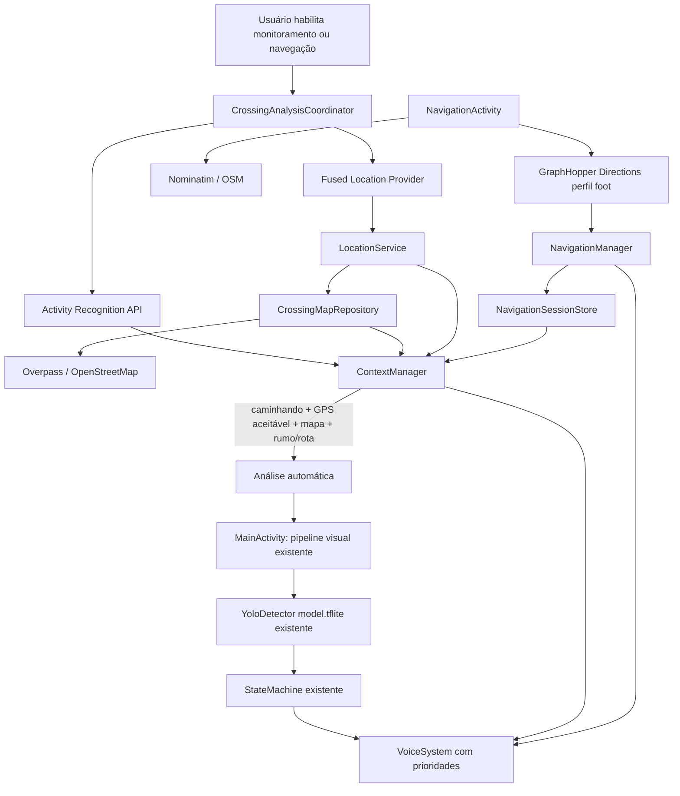

# GPS, navegação acessível e ativação contextual — SenseWalk 2.4

## 1. Objetivo

Esta implementação acrescenta ao aplicativo Android nativo uma camada **experimental** de contexto para travessias e uma tela de navegação a pé acessível. Ela mantém integralmente o único pipeline existente de visão computacional (`YoloDetector` + `FrameAnalyzer`/`ExternalFrameProcessor`) e **não altera** `model.tflite`, pesos, classes, índices ou parâmetros do YOLOv8.

Os novos recursos são auxiliares: localização, mapa e visão não autorizam uma travessia. O app passou a usar mensagens descritivas, por exemplo, “Semáforo vermelho identificado. Aguarde.” e “Não foi possível confirmar as condições da travessia.”

## 2. Arquitetura implementada



### Componentes

| Componente | Responsabilidade |
| --- | --- |
| `location/LocationService.kt` | Atualizações de localização em primeiro plano, precisão e permissões. |
| `context/ContextManager.kt` | Máquina de estados `STOPPED`, `STATIONARY`, `WALKING`, `POSSIBLE_CROSSING`, `ANALYSING_CROSSING`; histerese, confirmação e cooldown. |
| `context/CrossingAnalysisCoordinator.kt` | Une localização, Activity Recognition, Overpass, rota ativa, voz e o callback para a análise visual existente. |
| `navigation/CrossingMapRepository.kt` | Consulta Overpass, normalização/deduplicação de pontos, timeout e cache em memória. |
| `navigation/GraphHopperRouteRepository.kt` | Rota de pedestre real via API GraphHopper, quando configurada. |
| `navigation/PlaceSearchRepository.kt` | Pesquisa de destino via Nominatim/OSM disparada somente por ação do usuário. |
| `navigation/NavigationManager.kt` | Sessão de rota, instruções, chegada, desvio e solicitação de recálculo. |
| `voice/VoiceNavigationManager.kt` | Encaminha avisos GPS/contexto por prioridade ao `VoiceSystem` existente. |

## 3. Tecnologias utilizadas

- Kotlin e Android nativo; não foi feita migração para React Native.
- CameraX, entrada X5, TensorFlow Lite e o YOLO já existentes.
- Google Play services Location 21.3.0: Fused Location Provider e Activity Recognition API.
- OpenStreetMap: Nominatim para busca e Overpass para elementos de travessia.
- GraphHopper Directions API, perfil `foot`, para roteamento.
- Android `TextToSpeech` e `SpeechRecognizer` para instruções e destino por voz.
- `org.json` e `HttpURLConnection`; não foi adicionada uma biblioteca HTTP pesada.

## 4. Configuração das APIs

### GraphHopper

GraphHopper exige chave. Crie uma chave compatível com o endpoint Directions API e adicione-a **somente** ao arquivo não versionado `Projeto_Android/local.properties`:

```properties
sdk.dir=C\:\\Users\\Admin\\AppData\\Local\\Android\\Sdk
GRAPHHOPPER_API_KEY=sua_chave_aqui
```

Também é possível fornecer `GRAPHHOPPER_API_KEY` como propriedade Gradle ou variável de ambiente (útil em CI). A chave vira `BuildConfig.GRAPHHOPPER_API_KEY`; não há chave incluída no código ou neste repositório. Sem ela, a busca de locais continua funcionando, mas o cálculo de rota mostra que está pendente de configuração.

Antes da demonstração, confira na documentação e no painel da conta GraphHopper a cobertura de pedestres, cota, custo e limites atuais. O endpoint utilizado é o documentado `https://graphhopper.com/api/1/route`, com `profile=foot`, `instructions=true` e `points_encoded=false`.

### OpenStreetMap / Overpass / Nominatim

As instâncias públicas são serviços comunitários, sem garantia de disponibilidade. O app identifica-se com `User-Agent`, usa timeout, só pesquisa Nominatim mediante botão/voz e mantém cache Overpass de 60 s (reutilizado até deslocamento de 45 m). Não faça consultas por atualização de GPS nem use a instância pública como backend de produção.

É necessário manter a atribuição OpenStreetMap/colaboradores em qualquer material ou tela que apresente dados derivados do mapa.

## 5. Ativação automática da análise

1. Em **Ajustes > Navegação e monitoramento**, ative “Monitoramento de caminhada” e “Análise automática”.
2. No retorno à tela principal, conceda localização e, em Android 10+, reconhecimento de atividade.
3. O `ActivityRecognitionReceiver` informa caminhada/parado. Se indisponível, a velocidade do GPS é somente um fallback.
4. O `LocationService` recusa leituras acima da precisão configurada (padrão: 35 m).
5. O repositório consulta/cached travessias em 100 m e considera `highway=crossing`, `highway=traffic_signals`, `crossing=traffic_signals`, `crossing=zebra`, `crossing=uncontrolled` e `crossing=marked`.
6. Para pedir a análise são necessárias duas leituras compatíveis, usuário caminhando, ponto dentro do limiar (padrão: 30 m), rumo não claramente contrário e, se houver rota ativa, proximidade de até 35 m da geometria da rota.
7. O coordenador chama `MainActivity.setAnalysisActive(true, automatic = true)`: é o mesmo `FrameAnalyzer`/`YoloDetector` manual, sem uma segunda câmera nem inferência concorrente.
8. A histerese de saída padrão é 15 m, evitando alternância quando a leitura oscila perto do limiar. A sessão automática encerra de forma controlada após 45 s por padrão; o cooldown padrão é 90 s. Histerese e cooldown podem ser ajustados em Ajustes. O usuário pode iniciar/parar a análise manualmente a qualquer momento.

O monitoramento e a câmera automática só operam enquanto a tela está em primeiro plano. Ao pausar/sair, o app remove atualizações e não tenta contornar as restrições de câmera em segundo plano. Esta versão não cria serviço em primeiro plano.

## 6. Navegação acessível

O botão **Navegar** abre `NavigationActivity`, com:

- campo grande para destino por texto;
- botão **Dizer destino** usando `SpeechRecognizer` real;
- pesquisa de até cinco resultados no Nominatim e seleção acessível;
- distância e duração estimada da rota a pé;
- iniciar, pausar, encerrar e repetir a instrução;
- status de GPS e região de atualização acessível ao leitor de tela.

`NavigationManager` anuncia instruções retornadas pelo serviço de rota quando o usuário chega próximo ao ponto correspondente, avisa proximidade do destino e pede recálculo somente após três leituras afastadas mais de 35 m da geometria. “Rota recalculada” é falado somente depois de uma nova resposta GraphHopper bem-sucedida.

Depois de iniciar a rota, voltar para a tela principal transfere a sessão em memória para ela: a navegação por voz, o contexto GPS/OSM e a análise visual automática podem então operar juntos no mesmo primeiro plano. Ao minimizar/sair do aplicativo, as atualizações são removidas; não existe serviço de localização/câmera em segundo plano nesta entrega.

## 7. Integração GPS + OSM + YOLO

A rota GPS continua funcionando mesmo se não existir semáforo no mapa ou se a visão não o identificar. A existência de um item OSM indica apenas um contexto cartográfico; ela não informa a cor do semáforo. Do outro lado, a análise YOLO só é ativada quando o contexto tem indícios suficientes e continua sendo a única fonte de identificação visual de veículos, faixa e cor do semáforo.

Prioridades de voz: **segurança** > **contexto de travessia** > **navegação** > informação. Assim uma instrução de curva não deve se sobrepor a um aviso visual importante.

## 8. Permissões Android

| Permissão | Uso |
| --- | --- |
| `CAMERA` | Pipeline visual existente. |
| `ACCESS_FINE_LOCATION` / `ACCESS_COARSE_LOCATION` | Navegação e contexto de travessia em primeiro plano. |
| `ACTIVITY_RECOGNITION` | Caminhando/parado em Android 10+. |
| `RECORD_AUDIO` | Comandos e destino por voz. |
| `INTERNET` / rede | Overpass, Nominatim e GraphHopper. |

Não foi adicionada `ACCESS_BACKGROUND_LOCATION`, nem serviço para manter câmera em segundo plano.

## 9. Bateria e desempenho

- O YOLO não roda no monitoramento leve; somente durante análise manual ou automática confirmada.
- O código reutiliza a única instância do detector e os analisadores existentes.
- CameraX usa `STRATEGY_KEEP_ONLY_LATEST`; a X5 já descarta frames vencidos.
- Localização tem intervalo configurável (padrão 8 s).
- Overpass usa timeout, cache e distância mínima antes de nova consulta.
- I/O de mapa/rota ocorre em `Dispatchers.IO`; atualizações de interface voltam à thread principal.
- Ao sair da tela, atualizações de localização/atividade são removidas.

## 10. Limitações e segurança

- SenseWalk é uma ferramenta assistiva experimental, não certificada para garantir travessias seguras.
- Ausência de veículo no frame, GPS isolado, item OSM ou luz verde não autorizam atravessar.
- Mapa pode estar incompleto/desatualizado; GPS urbano pode ser impreciso; serviços externos podem falhar ou aplicar cota.
- A rota sem uma chave GraphHopper configurada fica deliberadamente indisponível; não há simulação substituindo integração real.
- A câmera deve estar disponível e o usuário deve manter o app em primeiro plano para análise automática.
- Não foram alterados pesos/classes/índices do modelo. Não há retreinamento nesta entrega.

## 11. Testes executados e previstos

Foram adicionados testes JVM para:

1. cálculo de distância e rumo (`GeoMathTest`);
2. interpretação de nós/vias Overpass, tipos e ausência de dados (`CrossingMapParserTest`);
3. deduplicação de elementos OSM (`CrossingMapParserTest`);
4. aproximação, estados, cooldown, baixa precisão/perda de GPS e término controlado (`ContextManagerTest`);
5. falha de rede sem criação de dados fictícios (`CrossingMapRepositoryTest`);
6. continuidade de instruções, desvio/recalculo e cancelamento de sessão (`NavigationProgressPolicyTest`);
7. prioridade de voz (`VoiceMessageSchedulerTest`);
8. política de permissões de localização (`LocationPermissionPolicyTest`).

`testDebugUnitTest` foi executado com sucesso nesta entrega (25 testes, incluindo os 7 testes X5 já existentes) e `assembleDebug` também foi concluído com sucesso. Validação em aparelho continua obrigatória para permissões reais, Fused Location, Activity Recognition, rede, TTS, câmera e credencial GraphHopper.

## 12. Como executar

1. Abra `Projeto_Android` no Android Studio.
2. Configure Android SDK API 35 e um JDK compatível com AGP 8.13.2.
3. Se desejar roteamento, configure a chave GraphHopper em `local.properties` conforme a seção 4.
4. Sincronize o Gradle e execute em aparelho físico com Google Play services.
5. Conceda câmera; para navegação, localização; para monitoramento, Activity Recognition; e microfone para voz.
6. Para teste automático, ative as duas opções em Ajustes e mantenha a tela principal visível.
7. Para navegar, toque em **Navegar**, pesquise/dita um destino, selecione-o, calcule e inicie a rota.

Para rodar testes e build em máquina configurada:

```powershell
cd Projeto_Android
.\gradlew.bat testDebugUnitTest
.\gradlew.bat assembleDebug
```

## 13. Demonstração acadêmica sugerida

1. Explique que o modelo TFLite existente está preservado e apresente o fluxo Mermaid.
2. Mostre as permissões e as opções de monitoramento desligadas por padrão.
3. Ative o monitoramento em área controlada com GPS confiável; mostre o status caminhando, a consulta mapeada e a ativação do mesmo botão/pipeline de análise.
4. Use uma rota curta com chave GraphHopper válida, mostre pesquisa Nominatim, distância/duração e instruções por voz.
5. Demonstre um cenário sem mapa/rede ou GPS ruim para mostrar os avisos de incerteza.
6. Demonstre uma luz vermelha ou vídeo controlado e confirme que a mensagem é “identificado, aguarde”; nunca encene o aplicativo como autorização para atravessar uma rua real.
